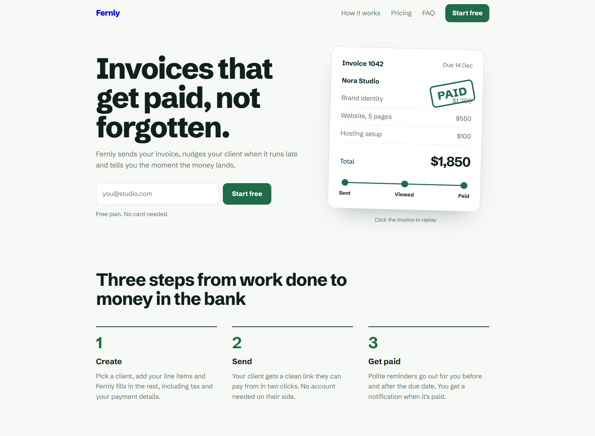

# Fernly: SaaS Landing Page

A clean, conversion-focused landing page for a fictional invoicing app for freelancers. Built to show how a product page can explain value quickly and let visitors interact with it.

**Live demo:** https://ipasjok.github.io/saas-landing-page/

## Features

- **Animated invoice mockup** in the hero: the invoice moves from Sent to Viewed to Paid, finishing with a stamp. Click it (or press Enter) to replay.
- **Savings calculator** with two sliders (invoices per month, hourly rate) that shows time and money saved in real time.
- **Pricing table with a monthly/yearly toggle** that updates prices with a short animation.
- **FAQ accordion** built on native `
` elements, so it works without JavaScript.
- **Signup forms** with email validation and clear success and error messages.
- **Scroll animations** that reveal sections as you reach them.

## Design and quality

- Fully responsive, from small phones to wide desktops
- Keyboard accessible, with visible focus states and a proper switch role on the pricing toggle
- Respects the `prefers-reduced-motion` setting by turning animations off
- Light, calm palette (fern green, sage and warm yellow) with a single typeface, Schibsted Grotesk
- Pricing shown as one table instead of three identical cards, to keep the layout distinctive

## Tech

HTML, CSS and vanilla JavaScript in a single file. No frameworks, no build step and no dependencies apart from one Google Fonts stylesheet. The page loads fast and is easy to hand over or extend.

## Run locally

1. Download `index.html`.
2. Open it in any modern browser.

## Customize

- Colors and spacing live in the `:root` variables at the top of the stylesheet.
- Plans and prices are plain HTML with `data-m` (monthly) and `data-y` (yearly) attributes.
- To receive real signups, connect the forms to a service such as Formspree, Netlify Forms or your own backend.

## Note

This is a concept project. Fernly is a fictional product, and the signup forms do not send any data.

## License

MIT
